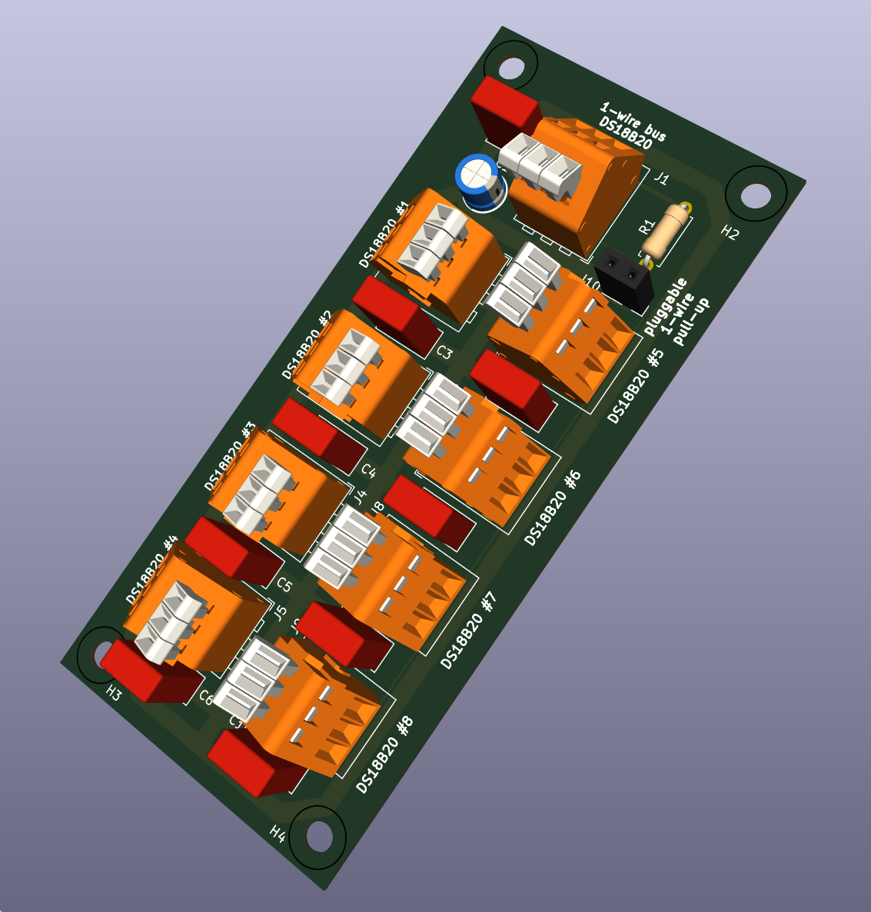
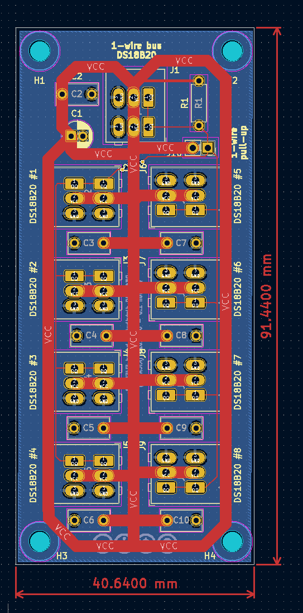
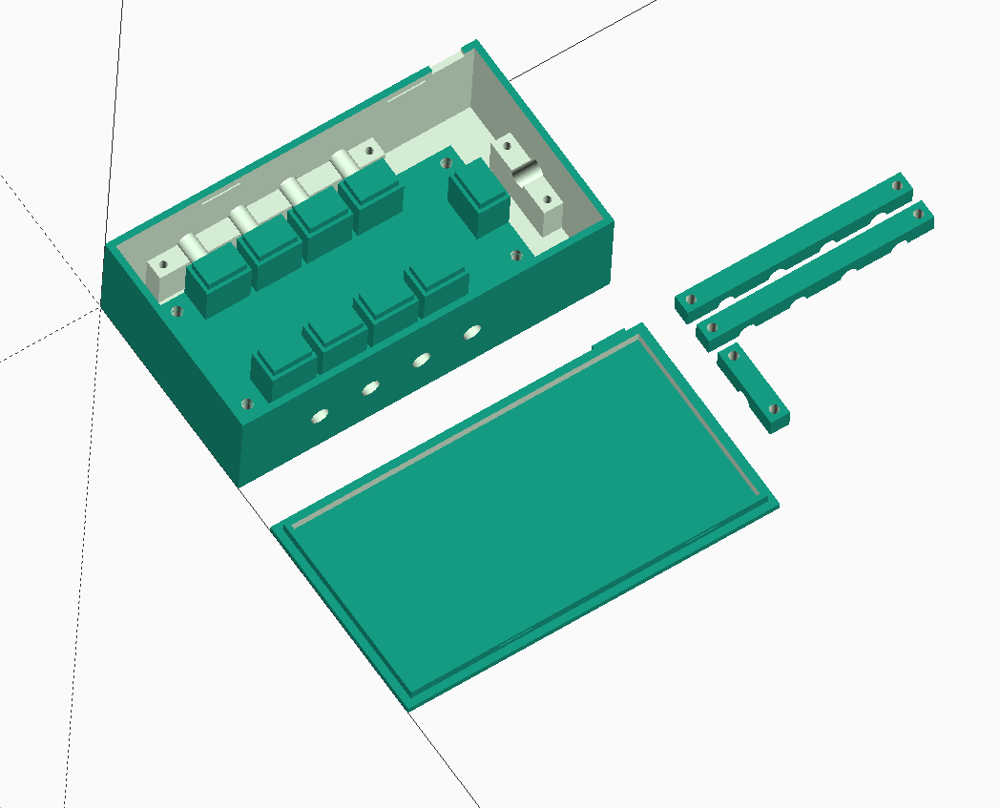

# DS18B20_distribution_board_FUEL4EP  

**Verteilerplatine für bis zu 8 DS18B20 Temperatursensoren**

-
	  
	  

## Status

- noch nicht bei JLCPCB gefertigt und daher auch nicht validiert

## Eigenschaften  
- generische Verteilerplatine von 1-wire Bus auf bis zu 8 DS18B20 Sensoren  
- einfache Klemmmöglichkeit durch [Wago Leiterplattenklemmen 233-503](https://www.wago.com/de/leiterplattenanschluss/klemmenleiste-fuer-leiterplatten/p/233-503)  
- kein Schrauben oder Löten ist notwendig  
- Pufferkondensatoren 100 nF (RM5) und 10 uF (RM2)  
- 1-wire Pullup-Widerstand R1 (L7.5) ist einlötbar oder alternativ auf J10 Buchsenleiste einsteckbar
- Platinenmaße: 40,64 mm x 91,44 mm (1,6 Inch x 3,6 Inch)  
- Lochabstände der M3 Befestigungslöcher: 32,839 mm x 83,566 mm
 
- kompletter Datensatz für KiCAD 8 auf Github verfügbar:
    + 'git clone https://github.com/FUEL4EP/HomeAutomation.git' oder als [ZIP-Datei](https://github.com/FUEL4EP/HomeAutomation/archive/refs/heads/master.zip)
    + die Platinendaten sind dann unter 'HomeAutomation/AsksinPP_developments/PCBs/DS18B20_distribution_board_FUEL4EP' direkt mit KiCAD aufrufbar

### Passende AsksinPP Platinen von FUEL4EP
- [HB-UNI-SEN-BATT_ATMega1284P_E07-900MM10S_FUEL4EP](https://github.com/FUEL4EP/HomeAutomation/tree/master/AsksinPP_developments/PCBs/HB-UNI-SEN-BATT_ATMega1284P_E07-900MM10S_FUEL4EP)
- [HB-UNI-SEN-BATT_ATMega1284P_E07-868MS10_FUEL4EP](https://github.com/FUEL4EP/HomeAutomation/tree/master/AsksinPP_developments/PCBs/HB-UNI-SEN-BATT_ATMega1284P_E07-868MS10_FUEL4EP)
- [HB-UNI-SEN-BATT_E07-900MM10S_FUEL4EP](https://github.com/FUEL4EP/HomeAutomation/tree/master/AsksinPP_developments/PCBs/HB-UNI-SEN-BATT_E07-900MM10S_FUEL4EP)
- [HB-UNI-SEN-BATT_FUEL4EP](https://github.com/FUEL4EP/HomeAutomation/tree/master/AsksinPP_developments/PCBs/HB-UNI-SEN-BATT_FUEL4EP)
- .. und viele weitere AsksinPP Platinen mit 1-wire Anschlussmöglichkeit

### Passendes Gehäuse

- ein parametrisierbares openSCAD Gehäuse ist im Verzeichnis [case](./case)  
- [DS18B20_distribution_box.scad](./case/DS18B20_distribution_box.scad):
-   
- das 3D Modell des Gehäuses ist noch nicht 3D gedruckt und validiert worden
   

### KiCAD Plugin
- für die Erzeugung der JLCPCB Produktionsdaten wurde das Plugin [KiCAD JLCPCB tools](https://github.com/bouni/kicad-jlcpcb-tools) verwendet.

## Bestellen von Platinen

- die Platine kann direkt bei JLCPCB bestellt werden.
- die notwendigen Produktionsdaten stehen [hier](./jlcpcb/production_files/)

## Disclaimer

-   die Nutzung der hier veröffentlichten Inhalte erfolgt vollständig auf eigenes Risiko und ohne jede Gewähr.

## Versionsverlauf

-   V1.0 08.09.2026
- 	KiCad Schaltplan-Editor   8.0.9-8.0.9-0~ubuntu22.04.1, release build, release build unter Kubuntu22.04.1
- 	KiCad Leiterplatteneditor Version: 8.0.9-8.0.9-0~ubuntu22.04.1, release build unter Kubuntu22.04.1
- 	PCB Version 1.0 08.09.2026
- 	Schematics  1.0 07.09.2026

## Lizenz 

**Creative Commons BY-NC-SA [CC BY-NC-SA 4.0](https://creativecommons.org)** 
Give Credit, NonCommercial, ShareAlike

**Ausnahmen für manche KiCAD 3D CAD-Modelle:** 
Im zentralen Ordner für zusätzliche KiCAD 3D-Modelle [FUEL4EP_kicad_3D_models](../FUEL4EP_kicad_3D_models) befinden sich auch STEP Dateien herstellerspezifischer Bauteile, die unter abweichenden Lizenzen (wie z.B. CC BY-ND 4.0) stehen. Details dazu sind in den dort hinterlegten `LICENSE_\<supplier\>.txt Dateien und/oder im [README](../FUEL4EP_kicad_3D_models/README.md) zu finden.

 This work is licensed under a <a rel="license" href="http://creativecommons.org/licenses/by-nc-sa/4.0/">Creative Commons Attribution-NonCommercial-ShareAlike 4.0 International License</a>.

-EOF
	

